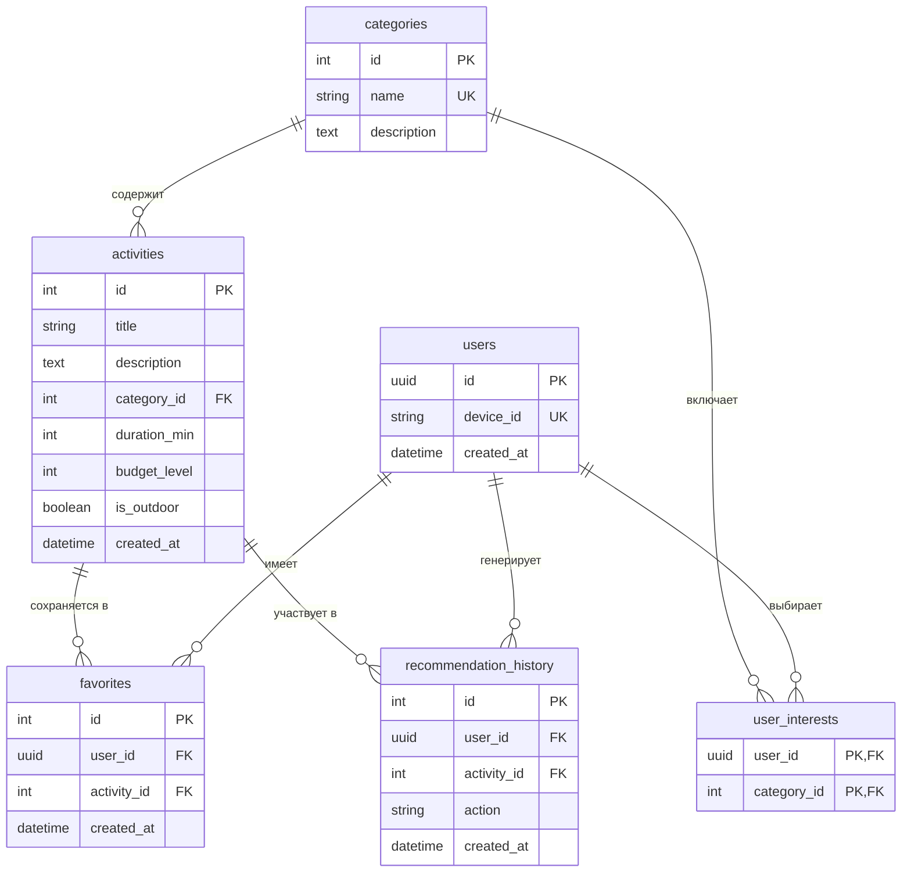

# Схема базы данных (ER-диаграмма)

## ER-диаграмма сущностей

## Описание таблиц и связей

- **users**: Хранит данные пользователей (включая анонимных по device_id). Связь один-ко-многим с избранным и историей рекомендаций, многие-ко-многим с категориями через user_interests.
- **categories**: Справочник категорий досуга.
- **activities**: Каталог занятий. Включает привязку к категории (category_id), фильтры по времени (duration_min), бюджету (budget_level) и локации (is_outdoor).
- **user_interests**: Таблица связи M2M для сохранения интересов пользователя, выбранных на онбординге.
- **favorites**: Избранные активности пользователя.
- **recommendation_history**: История предложенных активностей и реакций пользователя (shown, accepted, skipped) для работы рекомендательного алгоритма.
